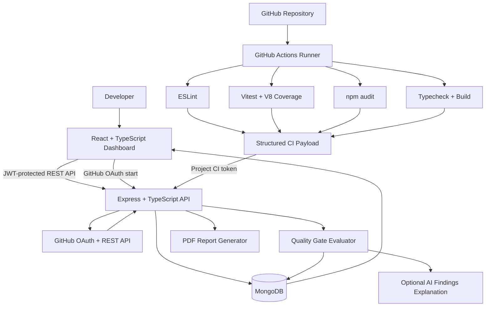
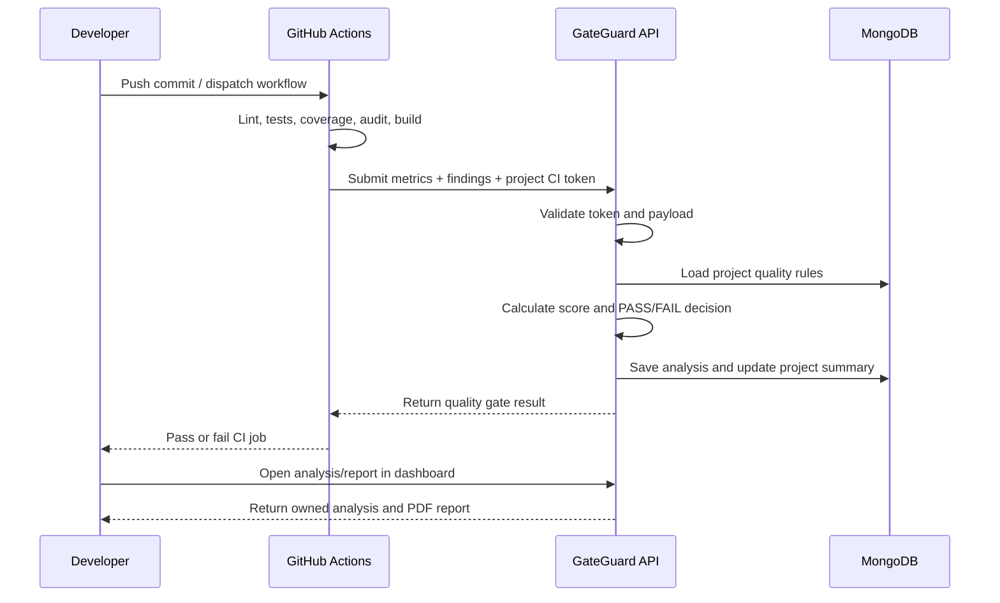

# GateGuard — System Architecture

## Component overview

## Trust boundaries

1. **Browser boundary:** the browser calls authenticated REST endpoints. The API validates the JWT and checks the current user session version.
2. **API boundary:** all project, analysis, rule and report queries are scoped to the authenticated owner.
3. **Repository execution boundary:** GateGuard's API never clones or executes customer repository code. GitHub Actions executes checks in the hosted runner and sends only structured results to the API.
4. **CI ingestion boundary:** each project has a random CI token. GateGuard stores only its SHA-256 hash and compares submitted credentials using a timing-safe comparison.
5. **GitHub credential boundary:** OAuth uses one-time expiring state; the GitHub access token is encrypted with AES-256-GCM before storage.

## Main analysis sequence

## Core data entities

- **User:** account identity, password hash, GitHub identity, encrypted GitHub credential, password-reset state and token version.
- **Project:** owner, GitHub repository identity, default branch, hashed CI token and latest quality summary.
- **QualityRule:** owner/project-scoped coverage, test pass-rate, lint and vulnerability thresholds.
- **Analysis:** owner, project, commit, branch, structured metrics, findings, rule results, score, gate status and AI explanation.
